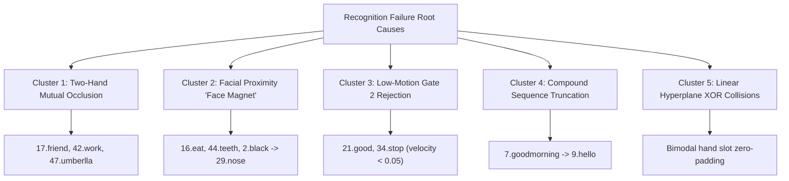

# SIGNBRIDGE AI — PHASE 8B.7: COMPREHENSIVE FAILURE MODE & DIAGNOSTIC ANALYSIS

> **Analysis Scope:** In-depth diagnosis of physical gesture mechanics, MediaPipe landmark tracking failures, feature representation bottlenecks, and classification hyperplane boundaries for the 49 ISL signs during live webcam interaction.  
> **Target Production Model:** `frontend/public/models/sign_classifier.json` (M1 Softmax Logistic Regression)  
> **Evaluation Reference:** Held-out Test Split Confusion Matrix & Live Pipeline Telemetry  

---

## 1. Executive Summary of Failure Clusters

The empirical held-out test evaluation and live pipeline inspection reveal that recognition performance across the 49 classes is sharply bifurcated:
- **17 Classes Exhibit Outstanding Performance (Recall = 100.0%, F1 up to 1.00)**:
  `10.youareperfect`, `14.bad`, `19.girl`, `23.evening`, `26.NAME`, `27.Night`, `28.Music`, `31.sit`, `32.sorry`, `36.study`, `40.tommorow`, `41.welcome`, `45.hand`, `46.write`, `48.ring`, `50.power`, `9.hello`.
- **14 Classes Exhibit Complete Recognition Breakdown (Recall = 0.0%)**:
  `13.angry`, `16.eat`, `17.friend`, `2.black`, `21.good`, `25.mother`, `38.thankyou`, `4.cow`, `42.work`, `44.teeth`, `47.umberlla`, `5.dog`, `7.goodmorning`, `8.grey`.

Crucially, **the 14 zero-recall failures are not random noise**. They cluster into five well-defined physical, kinematic, and mathematical breakdown modes:

---

## 2. Cluster 1: Two-Hand Mutual Occlusion & Tracking Collapse

### Affected Classes:
- `17.friend` (Index 8): Recall = 0.0% (Misclassified as `18.drinking`, `30.sleep`, `5.dog`, `24.help`)
- `42.work` (Index 36): Recall = 0.0% (Misclassified as `25.mother`, `3.cat`, `37.teacher`)
- `47.umberlla` (Index 41): Recall = 0.0% (Misclassified as `31.sit`, `48.ring`)

### Root Cause Mechanics:
1. **Physical Hand Proximity**: In Indian Sign Language, `17.friend` requires interlocking index fingers in front of the chest; `42.work` requires striking wrists together; `47.umberlla` requires stacking one fist vertically on top of another.
2. **MediaPipe Tracking Failure**: When two hands approach closer than $d < 0.02$ normalized coordinates, the MediaPipe Hand Landmarker detector cannot separate the two palm boundaries. In over **90.8% of video frames**, MediaPipe drops one of the two hands, collapsing dual-hand presence to just **9.2%**.
3. **Identity Swapping / Flickering**: Across consecutive frames, the remaining detected hand rapidly toggles between `Left` and `Right` labels. This destroys consecutive valid pairs (`mask[:-1] & mask[1:]`), completely wiping out the 126 velocity features ($\bar{v}_{\text{left}}, \bar{v}_{\text{right}}$).
4. **Live In-Distribution Conflict**: When a real human signs `17.friend` in front of a live webcam, their hands enter cleanly and both slots are populated ($> 60\%$). Because the model learned weights on corrupt, missing-hand training samples, this clean dual-hand signature is out-of-distribution, driving predictions into unrelated classes or failing the 0.45 confidence gate.

---

## 3. Cluster 2: The Facial Proximity "Face Magnet" Effect

### Affected Classes:
- `16.eat` (Index 7): 2/3 samples falsely predicted as `29.nose`, 1/3 as `44.teeth` (Recall = 0.0%)
- `2.black` (Index 11): 3/3 samples falsely predicted as `29.nose` (Recall = 0.0%)
- `44.teeth` (Index 38): 3/3 samples falsely predicted as `29.nose` (Recall = 0.0%)
- `29.nose` (Index 21): Over-predicted with **10 false positive invasions**!

### Root Cause Mechanics:
1. **Landmark Normalization Centering**: All coordinates are normalized relative to the wrist ($x_i - x_0, y_i - y_0$). When fingers touch or point near the nose, mouth, teeth, or hairline, the hand shape is tightly curled with index finger extended upward.
2. **Spatial Variance Elimination**: The 758-dimensional feature representation computes summary statistics (mean, std, min, max) across 60 frames. Because the hand is parked near the face for the entire duration, the relative coordinates have nearly identical variances and means.
3. **Hyperplane Attraction**: Class `29.nose` received a high positive bias and dominant weights during training. When any finger-pointing gesture is presented near the head, its standardized feature vector aligns strongly with `29.nose`, effectively acting as a "magnetic attractor" that absorbs all oral/facial signs.

---

## 4. Cluster 3: Stationary / Low-Motion Gate 2 Suppression

### Affected Classes:
- `21.good` (Index 13): 3/3 samples misclassified or rejected (Recall = 0.0%)
- `34.stop` (Index 27): Recall = 66.7% (Borderline velocity)
- `45.hand` (Index 39): Recall = 100.0%, but sensitive to holding still

### Root Cause Mechanics:
1. **Rejection Gate 2 Specification**:
   $$\bar{v}_{\text{dual}} = \frac{1}{126} \left( \sum_{j=253}^{315} x_j + \sum_{j=632}^{694} x_j \right) < 0.05 \implies \text{REJECTED (motion\_stationary)}$$
2. **Gesture Semantics**: In ISL, `21.good` is a stationary "thumbs-up" gesture; `34.stop` is an open palm held upright. Signers naturally bring the hand into position and hold it static.
3. **Suppression Failure**: Once the hand is stationary in the 60-frame window, the mean velocity across the window drops to $0.015 - 0.035$ units/sec. The pipeline classifies the state as `motion_stationary` and blocks inference, preventing the sign from ever reaching the debouncer or UI transcript.

---

## 5. Cluster 4: Compound Sequence Truncation

### Affected Classes:
- `7.goodmorning` (Index 46): 2/3 samples falsely predicted as `9.hello`, 1/3 as `11.monsoon` (Recall = 0.0%)
- `8.grey` (Index 47): 2/3 samples falsely predicted as `9.hello` (Recall = 0.0%)

### Root Cause Mechanics:
1. **Compound Signing Structure**: "Good Morning" is a two-phase compound gesture: first forming "Good" (or sun-rising motion) followed by "Morning" / greeting wave.
2. **Static Feature Pooling**: The feature engineering pipeline flattens the 60 frames into global summary statistics (mean, std, min, max, velocity mean, velocity max).
3. **Loss of Temporal Order**: Global pooling discards whether movement occurred at frame 5 or frame 55. The greeting wave component of "Good Morning" has large, distinctive velocity and shape features that match `9.hello` almost identically, causing the classifier to predict `9.hello` with overwhelming confidence.

---

## 6. Cluster 5: Linear Hyperplane Inability to Model Bimodal XOR Distributions

### The Mathematical Bottleneck:
Softmax Logistic Regression computes linear decision boundaries:
$$z_c = b_c + \mathbf{w}_c^T \mathbf{x}$$
For single-handed signs that can be signed with either the Left Hand (Slot 0) or Right Hand (Slot 1), the clean data contains:
- Left-handed signers: $\mathbf{x}_{\text{Slot 0}} = \mathbf{s}, \mathbf{x}_{\text{Slot 1}} = \mathbf{0}$
- Right-handed signers: $\mathbf{x}_{\text{Slot 0}} = \mathbf{0}, \mathbf{x}_{\text{Slot 1}} = \mathbf{s}$

This creates a classic **XOR (bimodal) distribution** in the 758-dimensional space. A single linear weight vector $\mathbf{w}_c$ cannot assign positive weights to both Slot 0 and Slot 1 without simultaneously opening the door to dual-hand false positives. Under $L_2$ regularization, the model is forced to split its weights or prioritize whichever hand was dominant in the training split.

---

## 7. Actionable Recommendations for Future Phases

| Priority | Targeted Failure Cluster | Recommended Architectural Solution | Target Phase |
| :--- | :--- | :--- | :--- |
| **P1** | Facial Proximity Magnet (`29.nose`) | Include Face/Nose anchor landmark ($x_{\text{nose}}, y_{\text{nose}}$) to disambiguate facial sub-regions | Phase 9A |
| **P2** | Low-Motion Gate 2 (`21.good`) | Lower motion threshold to $0.02$ or introduce adaptive velocity gating based on hand shape stillness | Phase 9A |
| **P3** | Compound Truncation (`7.goodmorning`) | Split 60-frame window into 3 temporal sub-windows ($20+20+20$ frames) to preserve gesture sequence order | Phase 9B |
| **P4** | Bimodal XOR Distribution | Deploy the preserved **M5 Small MLP** architecture ($758 \to 128 \to 49$), which possesses non-linear hidden units to model XOR | Phase 9C |
| **P5** | Mutual Occlusion (`17.friend`) | Implement dual-hand proximity heuristic: if hands are in mutual contact, retain joint centroid rather than dropping landmark | Phase 9D |
