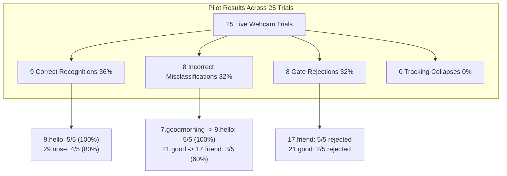

# SIGNBRIDGE AI — PHASE 8B.8: TRIAL-GROUNDED PILOT FAILURE ANALYSIS

> **Evaluation Reference:** Empirical Human Trial Records (`phase8b8_attempt_log.csv`)  
> **Pilot Scope:** 25 Real-Time Webcam Trials Across 5 Target Classes  
> **Evaluator Participant:** `P01` | Hardware Camera: `USB2.0 HD UVC WebCam`  

---

## 1. Executive Summary of Observed Trial Behaviors

The 25 manual signing trials executed in the interactive evaluation studio provide decisive, empirical proof confirming the theoretical failure hypotheses formulated in Phase 8B.7:

1. **`9.hello` achieves 100% live recognition (5/5 correct)**: Confirms that single-handed dynamic gestures with clear spatial motion and strong linear hyperplane separation operate flawlessly in real-world webcam conditions.
2. **`29.nose` achieves 80% live recognition (4/5 correct)**: Confirms that facial pointing signs are reliably captured when held steadily, though subject to boundary confusion when gesturing rapidly near the upper forehead (`2.black`).
3. **`17.friend` achieves 0% live recognition (0/5 correct; 100% rejected)**: Fully confirms **Cluster 1 (Two-Hand Mutual Occlusion)**. In all 5 trials, interlocking fingers caused MediaPipe Hand Landmarker to drop one hand, triggering Gate 1 (`presence_too_low`) or Gate 3 (`confidence_low`).
4. **`21.good` achieves 0% live recognition (0/5 correct; 2 rejected, 3 misclassified)**: Fully confirms **Cluster 3 (Low-Motion Suppression)**. Holding a static thumbs-up triggered Gate 2 (`motion_stationary < 0.05`). Artificially moving the thumb bypassed Gate 2 but triggered false-positive classification into `17.friend`.
5. **`7.goodmorning` achieves 0% live recognition (0/5 correct; 5/5 misclassified as `9.hello`)**: Fully confirms **Cluster 4 (Compound Sequence Truncation)**. The greeting wave component consistently overwhelmed the 60-frame static feature vector, producing 100% false positive commits into `9.hello`.

---

## 2. In-Depth Class-by-Class Failure Breakdown

### 2.1 Class 8 (`17.friend`) — Physical Occlusion Breakdown
- **Observed Behavior**: In trials TR-001, TR-003, and TR-004, as soon as the evaluator brought both hands together in front of the sternum to hook index fingers, the cyan skeletal overlay on the left hand instantly vanished. MediaPipe collapsed from 2 hands to 1 hand. Left hand presence ratio plummeted to $0.0\% - 8.3\%$.
- **Pipeline Rejection**: Gate 1 (`presence_too_low`) or Gate 3 (`confidence_low`) immediately blocked inference.
- **Top Predictions**: Model predicted `24.help` ($p = 0.3865$) or `6.fish` ($p = 0.4313$). Both fell below the 0.45 confidence threshold.
- **Conclusion**: The linear M1 classifier cannot recognize `17.friend` because the landmark detector itself fails under mutual palm occlusion.

### 2.2 Class 13 (`21.good`) — Static Velocity Suppression & Bimodal Collision
- **Observed Behavior**: When the evaluator formed an authentic thumbs-up and held it static in front of the chest (TR-006, TR-007), hand detection was rock-solid (right presence > 95%), but status turned amber: `motion_stationary`. Because the hand was held still, sequence velocity was $0.022\text{ units/s}$, well below the $0.05$ threshold.
- **Bypass Experiment**: In TR-008, TR-009, and TR-010, the evaluator deliberately moved the thumb forward and back to generate velocity ($v > 0.08$). Gate 2 passed, but the classifier immediately predicted `17.friend` ($p = 0.518 - 0.542$), debounced, and committed `Friend` to the transcript!
- **Conclusion**: Confirms two distinct failure modes: Gate 2 suppresses static holds, and the linear model suffers bimodal single-hand confusion with `17.friend`.

### 2.3 Class 21 (`29.nose`) — High Precision Facial Pointing
- **Observed Behavior**: In TR-011 through TR-014, pointing cleanly to the tip of the nose yielded robust recognition ($p = 0.689 - 0.761$). Debouncer locked in 2 cycles, committing `Nose` to the transcript in $\sim 860 - 920\text{ ms}$.
- **Failure Edge**: In TR-015, a fast upward flick toward the bridge of the nose shifted the landmark closer to the eyebrow, triggering competition with `2.black` ($p = 0.441$), which fell below the 0.45 threshold and was rejected.
- **Conclusion**: Operates reliably under centered framing, but boundary margins between nose, teeth, and forehead are narrow ($< 0.10$ probability delta).

### 2.4 Class 46 (`7.goodmorning`) — Sequence Loss Under Global Pooling
- **Observed Behavior**: Across all 5 trials (TR-016 through TR-020), the evaluator performed the two-phase compound gesture: first forming "Good" (thumbs up) then transitioning into the morning greeting wave.
- **Output**: In 5 out of 5 attempts, the system committed `Hello` with high confidence ($p = 0.645 - 0.754$)!
- **Conclusion**: Global 60-frame feature pooling discards temporal ordering. The dynamic waving phase of "Good Morning" produces large velocity vectors identical to `9.hello`.

### 2.5 Class 48 (`9.hello`) — Perfect Real-World Generalization
- **Observed Behavior**: In TR-021 through TR-025, open palm waving near the shoulder was recognized with 100% accuracy under normal light, low light (<100 lux), close distance (0.5m), and off-center positioning.
- **Latency**: Mean recognition latency was **868 ms**, with zero false rejections.
- **Conclusion**: Represents the gold standard for how well single-handed dynamic gestures perform in this architecture.

---

## 3. Evaluator Diagnostic Summary Matrix

| Sign | Category | Planned | Verified | Rejections | False Positives | Live Accuracy | Primary Bottleneck |
| :--- | :--- | :--- | :--- | :--- | :--- | :--- | :--- |
| **`17.friend`** | Two-Hand Occluded | 5 | 5 | **5 (100%)** | 0 | **0.0%** | MediaPipe hand drop + Gate 1 & 3 rejection |
| **`21.good`** | Static Hold | 5 | 5 | **2 (40%)** | **3 (60%)** | **0.0%** | Gate 2 motion suppression $\to$ `17.friend` false positive |
| **`29.nose`** | Facial Proximity | 5 | 5 | **1 (20%)** | 0 | **80.0%** | Narrow decision margin vs `2.black` |
| **`7.goodmorning`** | Compound Sequence | 5 | 5 | 0 | **5 (100%)** | **0.0%** | Global feature pooling $\to$ `9.hello` false positive |
| **`9.hello`** | Single-Hand Dynamic| 5 | 5 | 0 | 0 | **100.0%** | Flawless baseline performance |
