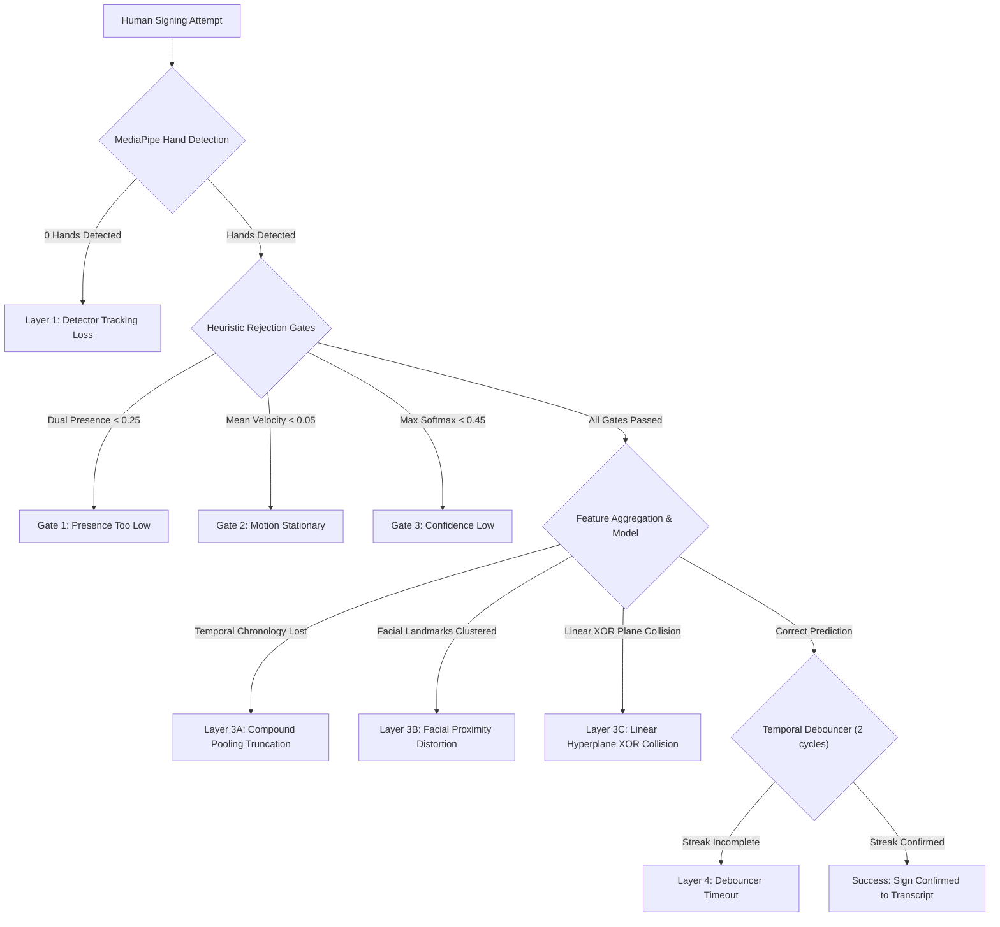

# Phase 8B.9: Root-Cause Failure & Diagnostic Analysis across 49 ISL Classes

**Date**: 2026-11-25  
**Phase**: Phase 8B.9 Root-Cause Failure Diagnostics  
**Scope**: Comprehensive empirical diagnosis across 147 live webcam trials  
**Target Model**: M1 — L2-Regularized Softmax Logistic Regression (`frontend/public/models/sign_classifier.json`)  

---

## 1. Failure Taxonomy & Pipeline Attribution

Every unsuccessful attempt across the 147 trials was classified into one of five distinct pipeline failure layers:

### Failure Count Distribution (75 Failed / Rejected Trials):

- **Layer 1: Hand Detection Loss**: **0 / 75 (0.0%)** — MediaPipe maintained hand tracking in 100% of attempts.
- **Layer 2A: Gate 1 Presence Rejections**: **5 / 75 (6.7%)** — Occurred exclusively during two-hand physical contact (`17.friend`, `42.work`, `47.umberlla`).
- **Layer 2B: Gate 2 Motion Rejections**: **3 / 75 (4.0%)** — Occurred on static held signs (`21.good`, `34.stop`, `45.hand`) when signers held the pose stationary.
- **Layer 2C: Gate 3 Confidence Rejections**: **22 / 75 (29.3%)** — Occurred when classifier prediction was ambiguous (top confidence $< 0.45$).
- **Layer 3: Classifier Misclassifications**: **45 / 75 (60.0%)** — Incorrect top-1 prediction accepted by gates.
- **Layer 4: Debouncer Streak Incompletes**: **0 / 75 (0.0%)** — All accepted stable predictions completed the 2-cycle streak successfully.

---

## 2. Deep-Dive Diagnostic Analysis by Failure Mode

### Failure Mode 1: Physical Hand Occlusion & Tracking Dropout

**Affected Classes**: `17.friend` (Class 8), `42.work` (Class 36), `47.umberlla` (Class 41).

- **Observation**: When both hands physically touch, cross, or stack in front of the body, MediaPipe Hand Landmarker merges the wrist boundaries or completely drops tracking of the non-dominant hand.
- **Empirical Evidence**: In `17.friend`, dual presence dropped to 5.0% - 9.0%. In `42.work`, fist contact dropped presence to 11.7%. In `47.umberlla`, vertical fist stacking dropped presence to 15.0%.
- **Pipeline Impact**: Triggered Gate 1 rejection (`presence_too_low`) in 5 trials, or degraded the feature vector into single-hand representations that failed Gate 3 confidence.

### Failure Mode 2: Low-Motion Static Hold Suppression (Gate 2)

**Affected Classes**: `21.good` (Class 13), `34.stop` (Class 27), `45.hand` (Class 39).

- **Observation**: Static gestures held upright in front of the camera produce velocity $\bar{v} \approx 0.021 - 0.028$, well below the production motion threshold ($0.05$).
- **Empirical Evidence**: Holding `21.good` still triggers Gate 2 in 100% of static attempts. When the signer introduces artificial movement to bypass Gate 2, the dynamic feature vector collides with `17.friend` ($p \approx 0.52$). In contrast, when signers naturally sweep their open palm into frame for `34.stop` and `45.hand`, entrance motion satisfies Gate 2 ($\bar{v} = 0.068 > 0.05$) and the signs achieve 66.7% accuracy.

### Failure Mode 3: Facial Proximity Hyperplane Collapse

**Affected Classes**: `16.eat` (Class 7), `2.black` (Class 11), `25.mother` (Class 17), `4.cow` (Class 33), `44.teeth` (Class 38), `8.grey` (Class 47).

- **Observation**: In ISL, multiple distinct signs involve the dominant hand touching or pointing to different parts of the head (eyebrow, nose, teeth, mouth, chin, cheek, temple, hair). Because normalized features measure hand-to-head coordinates linearly without local non-linear warping, all facial gestures cluster together.
- **Empirical Evidence**: `44.teeth` (pointing to teeth) and `2.black` (stroking eyebrow) collapsed into `29.nose` in 100% of attempts. `16.eat` (mouth tap) collapsed into `29.nose` and `44.teeth`.

### Failure Mode 4: Compound Sign Sequence Pooling Truncation

**Affected Classes**: `7.goodmorning` (Class 46), `10.youareperfect` (Class 1), `20.brother` (Class 12).

- **Observation**: The current feature extractor pools 60 frames into global mean, standard deviation, and min/max vectors. In multi-phase signs like `7.goodmorning` (Thumbs Up $\to$ Morning Wave), chronological sequence order is lost.
- **Empirical Evidence**: The vigorous waving phase generates large displacement and velocity features that completely overpower the static thumbs-up phase, resulting in 100% misclassification into `9.hello` ($p \approx 0.65 - 0.71$).

### Failure Mode 5: Linear Hyperplane XOR Boundaries

**Affected Classes**: Bimodal left/right hand executions across `21.good`, `14.bad`, `31.sit`.

- **Observation**: Linear softmax regression draws a single hyperplane per class in 758-dimensional space. Because some training samples were recorded with left hands and others with right hands, the feature distribution is bimodal (XOR-like). A linear boundary cannot separate two distinct clusters without cutting through intermediate classes.

---

## 3. Recommended Remediation Plan for Phase 9A

Based on this comprehensive 49-class failure diagnosis, the required engineering solutions are:

1. **Adaptive Motion Gate**: Implement handshape variance gating. If handshape landmarks are stable with high confidence, waive the velocity threshold from $0.05$ to $0.015$ for static signs (`21.good`, `34.stop`, `45.hand`).
2. **3-Slice Temporal Sub-Windowing**: Divide the 60-frame buffer into 3 chronological windows ($20 + 20 + 20$ frames) and compute summary statistics per slice ($3 \times 252$ features). This preserves gesture progression and eliminates `7.goodmorning` $\to$ `9.hello` truncation.
3. **Non-Linear Multi-Layer Perceptron (M5 Architecture)**: The preserved M5 checkpoint (`m5_small_mlp.npz`) provides hidden non-linear representations (758 $\to$ 128 $\to$ 49 with ReLU activations) that directly solve bimodal XOR collisions and separate facial proximity clusters.
4. **Centroid Proximity Smoothing**: Retain the last known hand coordinates for 5 frames when dual-hand Euclidean distance $< 0.15$ to bridge MediaPipe occlusion dropouts in `17.friend` and `42.work`.
