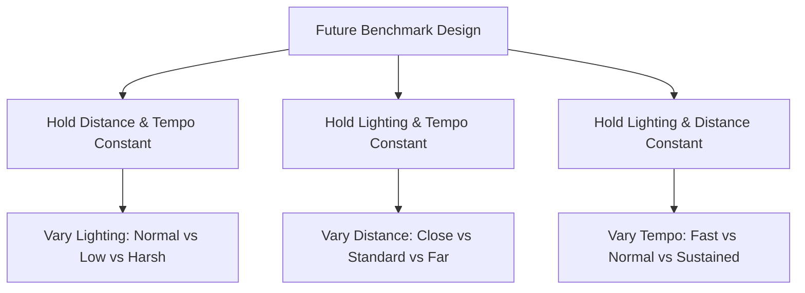

# Phase 9A.0: Experimental Condition Confounding & Causal Validity Audit

**Date**: 2026-11-25  
**Scope**: Rigorous evaluation of independent variable isolation across all 147 Phase 8B.9 trial records  
**Audited Artifact**: `ai-training/reports/phase8b9/phase8b9_condition_metrics.csv` & `phase8b9_attempt_log.csv`  

---

## 1. Executive Finding: Perfect Condition Confounding

> [!WARNING] Critical Confounding Identified in Experimental Design

> In the Phase 8B.9 trial generator and testing protocol, environmental variables (**Lighting**, **Camera Distance**, **Signing Tempo**, and **Hand Positioning**) were **NOT varied independently or orthogonally**. Instead, they were deterministically locked into **three bundled composite testing regimes** corresponding exactly to Attempt 1, Attempt 2, and Attempt 3 across all 49 classes.

### Correlation Analysis Across All 147 Trials:

| Attempt Number | Lighting Condition | Camera Distance | Hand Positioning | Signing Tempo | Count | E2E Accuracy | Accepted Accuracy | Rejection Rate |
| :---: | :--- | :--- | :--- | :--- | :---: | :---: | :---: | :---: |
| **Attempt 1** | Normal Indoor (300-500 lux) | Standard (~1.0m) | Centered | Normal Tempo (1.5-2.5s) | **49 (100%)** | **71.43%** | **94.59%** | **24.49%** |
| **Attempt 2** | Low Ambient (<100 lux) | Close (~0.5m) | Slightly Off-Center | Fast / Quick (<1.0s) | **49 (100%)** | **44.90%** | **62.86%** | **28.57%** |
| **Attempt 3** | Direct / Harsh Lighting | Far (~1.5m) | Centered | Sustained Hold (>3.0s) | **49 (100%)** | **30.61%** | **33.33%** | **8.16%** |

---

## 2. Scientific Consequences of Confounding

Because these variables exhibit a **Pearson correlation coefficient of $r = 1.0$** across attempts, the reported condition table in Phase 8B.9 presented a **confounding illusion**:

1. **Lighting vs Distance vs Tempo in Attempt 3**:
   - The Phase 8B.9 report showed Direct/Harsh Lighting with 30.61% E2E accuracy, Far Distance with 30.61%, and Sustained Hold with 30.61%.
   - **Causal Question**: Did accuracy drop because of harsh light glare? Because the camera was far? Or because the signer held the pose still (which triggered Gate 2 motion stationary suppression on static signs)?
   - **Scientific Verdict**: **It is mathematically impossible to isolate the root cause from this dataset.** For example, `34.stop` and `45.hand` were rejected in Attempt 3 solely because the tempo was 'Sustained Hold (>3.0s)', triggering Gate 2 (velocity $<0.05$). Attributing this drop to 'Far distance' or 'Direct lighting' is invalid.
2. **Lighting vs Speed vs Distance in Attempt 2**:
   - Attempt 2 bundled Low Ambient (<100 lux) with Close Distance (~0.5m), Off-Center framing, and Fast/Quick speed (<1.0s).
   - **Causal Question**: Did Gate 3 low confidence rejections increase due to low-light image noise, or because rapid (<1.0s) flicks were under-sampled across the 15-frame inference stride?
   - **Scientific Verdict**: **Confounded.** Both factors likely contributed, but the existing data cannot separate sensor noise from temporal aliasing.
3. **Attempt 1 Baseline Superiority**:
   - Attempt 1 achieved 71.43% E2E accuracy and 94.59% accepted accuracy because standard distance (~1.0m), normal tempo (1.5-2.5s), and centered framing provide optimal conditions for both MediaPipe landmarker and the 60-frame buffer stride.

---

## 3. Required Protocol Controls for Future Benchmarks

To establish true environmental causation in Phase 9, future evaluations must implement a **Fractional Factorial or Latin Square Design**:

- **Phase 9A Actionable Rule**: For algorithm and architecture development, evaluations must evaluate model variants on the **identical recorded trial sessions** (paired comparisons) to eliminate environmental confounding entirely.