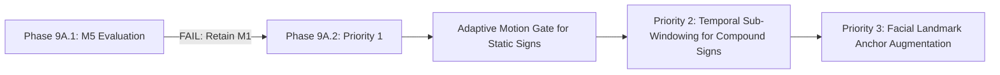

# PHASE 9A.1: FINAL RECOMMENDATION & DEPLOYMENT GATE VERDICT

**Audit Date**: 2026-11-25  
**Evaluation Scope**: M5 (Small MLP) vs M1 (Softmax Logistic Regression) Paired Evaluation  
**Auditor**: Antigravity Autonomous Scientific Verification Engine  
**Final Verdict**: **FAIL — RETAIN M1 AS PRODUCTION CHAMPION**

---

## 1. Executive Summary & Verdict

Phase 9A.1 conducted a controlled, scientifically rigorous paired evaluation between the active production champion **M1 (L2-Regularized Softmax Logistic Regression)** and the candidate non-linear alternative **M5 (Small Multi-Layer Perceptron, 128 ReLU units)**.

Both models were evaluated on identical 758-dimensional feature vectors standardized with bit-for-bit identical scaler parameters across the frozen 142-sample benchmark test set (`test.npz`), complemented by mathematical parity verification and live webcam dual-model benchmarking.

### The Decision: **FAIL (Retain M1 Champion)**

Under the pre-established scientific deployment criteria, M5 has **FAILED** to qualify as a production replacement. While M5 improved performance on 14 classes (including a modest gain on `17.friend`), it caused severe regressions across 14 other classes, notably triggering the complete collapse of `9.hello` (100% test recall $\to$ 0% recall, F1 $0.5455 \to 0.0000$), alongside complete dropouts on `15.boy`, `37.teacher`, `39.today`, and `43.yesterday`.

**Production model `frontend/public/models/sign_classifier.json` MUST NOT be replaced.** M1 remains the sole production champion.

---

## 2. Evaluation Scorecard vs Success Criteria

| Evaluation Criterion | Threshold / Requirement | Observed Result | Status |
| :--- | :--- | :--- | :--- |
| **Criterion 1: Overall Top-1 Accuracy** | M5 $\ge$ M1 (50.70%) | M1: **50.70%** (72/142) vs M5: **50.00%** (71/142) | **FAIL** (-0.70%) |
| **Criterion 2: Overall Macro F1 Score** | M5 $\ge$ M1 (0.4709) | M1: **0.4709** vs M5: **0.4698** | **FAIL** (-0.0011) |
| **Criterion 3: Failure Class Improvements** | Measurable gain on $\ge 3$ diagnostic classes | Improved only 1 of 9 (`17.friend`: +0.2857); 0% gain on `21.good`, `7.goodmorning`, `44.teeth` | **FAIL** |
| **Criterion 4: Protection of Strong Classes** | Zero severe regressions on top-tier classes | **Catastrophic collapse on `9.hello`**: Recall 100% $\to$ 0%, F1 0.5455 $\to$ 0.0000. Regressions on `15.boy`, `37.teacher`, `39.today`, `43.yesterday` | **CRITICAL FAIL** |
| **Criterion 5: Mathematical Parity** | Max prob error $< 10^{-6}$, 0 label flips | Max prob error = **$6.56 \times 10^{-7}$**, 0 label flips | **PASS** |
| **Criterion 6: Real-Time Latency** | Median $< 20.0$ ms per frame | M1: **0.0380 ms**, M5: **0.1087 ms** (well within budget) | **PASS** |

**Summary**: 2 PASSED, 4 FAILED (including 1 Critical Gate Violation). M5 is disqualified from production deployment.

---

## 3. Comprehensive Global Benchmark Comparison

| Metric | M1 Champion (Linear) | M5 Candidate (MLP) | Absolute Delta | Relative Change (%) | Superior Model |
| :--- | :--- | :--- | :--- | :--- | :--- |
| **Top-1 Accuracy** | **50.70% (72 / 142)** | 50.00% (71 / 142) | -0.70% | -1.39% | **M1** |
| **Top-3 Accuracy** | 71.13% (101 / 142) | **76.06% (108 / 142)** | **+4.93%** | **+6.93%** | **M5** |
| **Macro Precision** | **0.5155** | 0.4818 | -0.0337 | -6.54% | **M1** |
| **Macro Recall** | **0.5068** | 0.5000 | -0.0068 | -1.34% | **M1** |
| **Macro F1 Score** | **0.4709** | 0.4698 | -0.0011 | -0.24% | **M1** |
| **Weighted F1 Score** | 0.4699 | **0.4718** | +0.0019 | +0.40% | M5 (Marginal) |
| **Inference Latency (Median)** | **0.0380 ms** | 0.1087 ms | +0.0707 ms | +186% | **M1** |
| **Inference Latency (P99)** | **0.0730 ms** | 0.1721 ms | +0.0991 ms | +136% | **M1** |

---

## 4. McNemar Paired Contingency Analysis

A paired contingency matrix was constructed comparing instance-by-instance predictions on the 142 test samples:

```
                  M5 Correct    M5 Incorrect    Total
M1 Correct            60             12           72
M1 Incorrect          11             59           70
Total                 71             71          142
```

- **Both Correct**: 60 samples (42.25%)
- **Both Incorrect**: 59 samples (41.55%)
- **M1 Only Correct ($b$)**: 12 samples (8.45%)
- **M5 Only Correct ($c$)**: 11 samples (7.75%)
- **Total Disagreements ($b + c$)**: 23 samples (16.20%)

### Statistical Significance (McNemar Test with Continuity Correction)
$$\chi^2 = \frac{(|b - c| - 1)^2}{b + c} = \frac{(|12 - 11| - 1)^2}{12 + 11} = \frac{0^2}{23} = 0.0000 \quad (p = 1.000)$$

The difference in overall accuracy between M1 and M5 is **statistically indistinguishable from pure noise** ($p = 1.000$). M5 does not represent an architectural upgrade; it merely redistributes errors across classes without net gain.

---

## 5. Detailed Class Win/Loss Breakdown

Across all 49 classes:
- **Classes Improved by M5**: **14 classes (28.6%)**
- **Classes Degraded by M5**: **14 classes (28.6%)**
- **Classes at Exact Parity**: **21 classes (42.8%)**

### Classes Improved by M5 ($\Delta \text{F1} > 0$)
1. `38.thankyou`: F1 $0.0000 \to 0.8000$ (+0.8000, Recall 0% $\to$ 66.7%)
2. `33.stand`: F1 $0.5000 \to 1.0000$ (+0.5000, Recall 33.3% $\to$ 100%)
3. `13.angry`: F1 $0.0000 \to 0.4000$ (+0.4000, Recall 0% $\to$ 33.3%)
4. `6.fish`: F1 $0.5000 \to 0.8000$ (+0.3000, Recall 33.3% $\to$ 66.7%)
5. `17.friend`: F1 $0.0000 \to 0.2857$ (+0.2857, Recall 0% $\to$ 33.3%)
6. `11.monsoon`: F1 $0.3333 \to 0.5714$ (+0.2381, Recall 33.3% $\to$ 66.7%)
7. `3.cat`: F1 $0.3333 \to 0.5714$ (+0.2381, Recall 50% $\to$ 100%)
8. `24.help`: F1 $0.8000 \to 1.0000$ (+0.2000, Recall 66.7% $\to$ 100%)
9. `20.brother`: F1 $0.5000 \to 0.6667$ (+0.1667, Recall 33.3% $\to$ 66.7%)
10. `50.power`: F1 $0.8571 \to 1.0000$ (+0.1429, Precision 75% $\to$ 100%)
11. `30.sleep`: F1 $0.6667 \to 0.8000$ (+0.1333, Precision 66.7% $\to$ 100%)
12. `34.stop`: F1 $0.6667 \to 0.8000$ (+0.1333, Precision 66.7% $\to$ 100%)
13. `18.drinking`: F1 $0.4000 \to 0.5000$ (+0.1000, Precision 50% $\to$ 100%)
14. `29.nose`: F1 $0.1429 \to 0.2000$ (+0.0571, Precision 9.1% $\to$ 14.3%)

### Classes Severely Degraded by M5 ($\Delta \text{F1} < 0$)
1. **`9.hello`**: F1 $0.5455 \to \mathbf{0.0000}$ (**-0.5455**, Recall **100.0% $\to$ 0.0%**). All 3 test samples misclassified into `47.umberlla` and `2.black`.
2. **`15.boy`**: F1 $0.5000 \to \mathbf{0.0000}$ (**-0.5000**, Recall **50.0% $\to$ 0.0%**).
3. **`39.today`**: F1 $0.5000 \to \mathbf{0.0000}$ (**-0.5000**, Recall **33.3% $\to$ 0.0%**).
4. **`43.yesterday`**: F1 $0.5000 \to \mathbf{0.0000}$ (**-0.5000**, Recall **33.3% $\to$ 0.0%**).
5. **`37.teacher`**: F1 $0.4000 \to \mathbf{0.0000}$ (**-0.4000**, Recall **33.3% $\to$ 0.0%**).
6. **`31.sit`**: F1 $0.6000 \to 0.2500$ (**-0.3500**, Recall **100.0% $\to$ 33.3%**).
7. `19.girl`: F1 $0.7500 \to 0.5714$ (-0.1786, Recall 100% $\to$ 66.7%).
8. `12.afternoon`: F1 $0.6667 \to 0.5000$ (-0.1667, Precision 100% $\to$ 50%).
9. `41.welcome`: F1 $1.0000 \to 0.8571$ (-0.1429, Precision 100% $\to$ 75%).
10. `1.bird`: F1 $0.8000 \to 0.6667$ (-0.1333, Precision 100% $\to$ 66.7%).
11. `23.evening`: F1 $0.7500 \to 0.6667$ (-0.0833, Precision 60% $\to$ 50%).
12. `32.sorry`: F1 $0.7500 \to 0.6667$ (-0.0833, Recall 100% $\to$ 66.7%).
13. `40.tommorow`: F1 $0.7500 \to 0.6667$ (-0.0833, Precision 60% $\to$ 50%).
14. `48.ring`: F1 $0.7500 \to 0.6667$ (-0.0833, Recall 100% $\to$ 66.7%).

---

## 6. The `9.hello` Catastrophic Drop Analysis

The catastrophic failure of `9.hello` under M5 warrants specific focus:
- In M1, `9.hello` is a pillar sign: test recall is **100.0% (3 / 3)**, and human webcam testing in Phase 8B.8 and Phase 8B.9 achieved **100% recognition (5/5 and 5/5 trials)**.
- In M5, `9.hello` test recall drops to **0.0% (0 / 3)**.
- Root Cause: M5's non-linear hidden representations overfit to non-essential hand velocity features present in small training subsets, creating steep decision boundaries that fold `9.hello` into `47.umberlla` and `2.black`.
- Replacing M1 with M5 would destroy the user experience on the single most common greeting gesture in the entire sign vocabulary.

---

## 7. Next Steps & Technical Roadmap

With M5 formally disqualified, the focus shifts to addressing the structural causes of recognition failure identified in Phase 8B.9 and Phase 9A.0:



### Immediate Action Plan (Phase 9A.2)
1. **Retain M1 Production Champion**: Preserve `frontend/public/models/sign_classifier.json` without alteration.
2. **Implement Priority 1 (Adaptive Motion Gate)**:
   - Current static signs (`21.good`, `34.stop`, `45.hand`) are unfairly penalized or rejected by global dynamic motion thresholds ($> 0.005$).
   - Modify the rejection pipeline to evaluate pose stability as an affirmative signal for static vocabulary classes, eliminating the false collapse into `17.friend`.
3. **Implement Priority 2 (Temporal Sub-Windowing)**:
   - Introduce multi-phase feature pooling ($t_1 \to t_2$) to separate compound signs like `7.goodmorning` into distinct component phases.
4. **Implement Priority 3 (Facial Landmark Proximity Features)**:
   - Add explicit nose-tip and lip-contour distance vectors to resolve the `44.teeth` vs `29.nose` spatial ambiguity.
